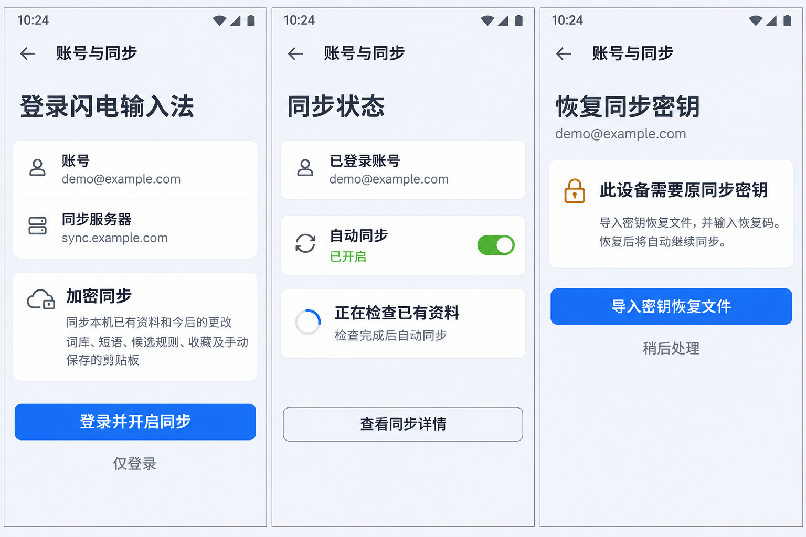

# Android 账号与自动同步 · 效果图

2026-11-24。用户已确认登录后自动同步的产品方向。本轮交付主 App 三屏视觉稿，当前等视觉确认。图中的账号和服务器是示例。

## 本轮评审

| 场景 | 用户看到什么 |
| --- | --- |
| 登录与开启 | 「登录并开启同步」把登录和一次明确授权放在主操作中。按钮上方说明本机已有资料和后续更改的同步范围。可选择「仅登录」。 |
| 日常同步 | 设置中的「同步状态」显示账号、自动同步开关和当前进度。效果图示例是「正在检查已有资料」。已开启、待发为空和整批完成分别呈现。 |
| 缺少原密钥 | 新设备登录后缺少原密钥时，进入「恢复同步密钥」。导入已有密钥恢复文件并输入独立恢复码。只有设备授权有效、材料匹配且已开启同步，才可自动继续。 |

沿用安卓版浅蓝灰底、白色卡片和蓝色主操作。绿色表示开关已启用，琥珀色表示需要用户处理。首屏正文把资料范围放在授权按钮之前，日常状态页仅提供查看和开关控制。

## 接手

1. 等视觉确认，再以本图画线稿并补交互。线稿要能区分仅登录、首次开启、自动检查、等待结果、同步已关闭及缺密钥、授权失效和冲突。预期首个可操作验收例为：合成账号登录并开启同步，一条合成短语经真实服务同步后在另一份本地库成功解密。
2. 在进入实现前评审三项独立依赖：账号登录与设备授权、可信的原密钥取得及本机绑定、已授权设备的自动同步触发与恢复。当前 Android 已有设备连接、密钥准备和显式手动同步。登录提供方、设备接续方式和自动执行时点留待交互与技术方案确定。
3. A2 草稿 PR #125 的合成双端服务验收可作为共享安全基础。A3 仍需实际 Android 页面、设备授权、自动执行与异常证据。当前验收为三个画面和文字的人工核对。

## 项目记忆

- 登录身份、设备授权、同步密钥和用户的同步同意各有边界。首次开启绑定当前服务器、账号、设备及密钥。仅登录保持本地；关闭、退出或切换账号停止发起新同步、保留本机资料。已发出的请求可能随后完成。
- 已开启后自动处理符合条件的本机资料。首轮先认证拉取至终止页，再核对存量版本与冲突；保留墓碑、原冻结请求和回执。只有校验并持久保存的回执证明服务器已确认。输入线程继续独立于同步。
- 视觉核对由主智能体完成，Astra 对改版范围与依赖做了独立只读审查。生成工具为内置 imagegen，提示词限定三个等宽的主 App 场景、准确简体中文、现有蓝灰原生设置样式、首屏范围文案、检查中状态和缺密钥恢复入口。

依据见 [Android 手动同步现有契约](../ANDROID_MANUAL_SYNC.md) 与 [A2 同步服务验收](https://github.com/ForceMind/ZapIME/actions/runs/45395869314)。
