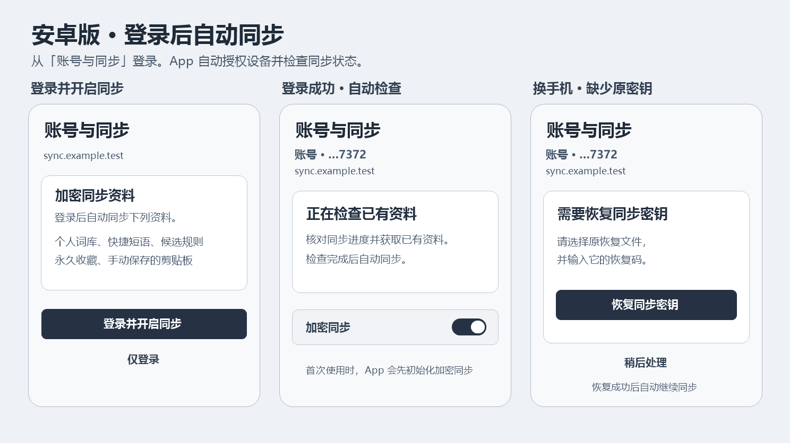

# Android 账号与自动同步 · 设计与交互

2026-11-24。用户已确认新版线稿和交互并批准实施。登录后自动授权设备并同步，换机缺原密钥时进入恢复。本稿中的账号和服务器为示例。

## 交互步骤

| 场景 | 操作与反馈 |
| --- | --- |
| 登录并开启 | 入口是主 App「账号与同步」。首屏在按钮前列出同步范围，包括已有及以后新增或修改的个人词库、快捷短语、候选规则、永久收藏和手动保存的剪贴板。用户点「登录并开启同步」并完成系统浏览器登录。回跳后显示「正在准备同步」，App 自动核对已有设备或为本机取得设备授权。处理期间合并重复操作。取消或失败时保持同步关闭，可重试。若服务器或账号与先前明确确认的目标不同，展示实际目标并重新取得同意。 |
| 仅登录 | 校验成功后显示账号，同步保持关闭，继续使用本机资料。之后可从开关查看范围并明确开启，同一页面自动完成设备授权和同步准备。 |
| 第一次使用同步 | 服务确认账号已开通、历史为空且尚无已登记密钥时，App 显示「正在初始化加密同步」，在本机生成密钥并登记公开描述符。成功后自动进入「正在检查已有资料」。另一台设备先登记时，以服务上胜出的密钥为准。本机缺这把原密钥时进入恢复。 |
| 原密钥已就绪 | 登录后自动进入「正在检查已有资料」。先认证拉取到本轮终止页，再核对本机已有记录、版本和来源。检查通过的待发操作自动加密同步。未读到终止页时从已保存游标继续。同步成功后在同一页显示实际完成时间与已确认写入。 |
| 自动日常同步 | A3 首个可运行版本在主 App 启动或回到前台时自动检查，前台内网络恢复时继续。已有任务时合并重复触发。状态页可随时打开查看，日常同步不需要逐条选择。后台调度进入后续技术评审。 |
| 换机缺原密钥 | 服务已登记密钥、本机缺少匹配材料时显示「需要恢复同步密钥」。用户选择原恢复文件并输入恢复码。取消、恢复码错误或材料不匹配时保留原资料并留在恢复状态。账号页「稍后处理」返回主界面，仍可继续使用本机资料。恢复原密钥后，账号、设备授权及开启同意仍有效时自动同步。 |

设备授权属于登录后的自动准备。可恢复的失败留在账号页，提示「重试同步准备」。服务未开通同步、原有历史缺少密钥描述符或账号与本机绑定冲突时，显示对应原因并暂停传输。这些状态保留本机资料，恢复提示取决于已核对的原密钥描述符。

## 同步状态与停止

| 用户看到的状态 | 触发条件和处理 |
| --- | --- |
| 已关闭 | 从未开启、仅登录或主动关闭。关闭后停止发起新传输，排队和未确认的冻结请求保留。重新开启显示当前账号和资料范围后再确认。 |
| 等待网络 / 正在检查 / 正在同步 | 前台离线时显示等待网络。网络可用后校验目标、设备、密钥及授权，再检查远端和本机，最后发送已冻结的实际操作。只显示真实进度。 |
| 等待核实 | 请求已发出，尚无已校验并保存的回执。重试时继续使用原冻结密文；服务端回执在本机验证、保存后才将对应版本标记为已确认。 |
| 最近同步成功 | 本轮已检查的范围显示完成时间。详情区分已确认的版本、已排队和仅在本机的变更。开关已开启、队列暂时为空与本轮同步结果分别显示。 |
| 有资料需要处理 / 设备授权失效 | 展示具体原因及入口，例如冲突详情、恢复密钥或重新授权。重叠 ID、词库重复、旧墓碑、来源无法核验或不同账号绑定均保留本机资料。拉取页被拒时整页回滚、游标保持原值，并暂停本轮。重新授权后再检查当前设备及密钥。 |

退出登录、关闭开关或切换账号使旧任务失效。已送达的请求可能随后完成，保留回执与原请求，在原目标恢复后核实。迟到的登录、密钥恢复或任务回调不得恢复已关闭的授权。同一设备重开 App 只承接本机持久保存的有效开启同意，并在发起本轮前重新校验；备份与恢复文件只作资料或密钥输入，不能提供开启许可。刚导入且来源无法核验的存量放在本机，状态页提示用户处理。

## 已确认的视觉稿

沿用安卓版浅蓝灰底、白色卡片和蓝色主操作。绿色表示开关已启用，琥珀色表示需要用户处理。首屏正文把资料范围放在授权按钮之前，日常状态页仅提供查看和开关控制。

## 接手

1. 简化三屏和交互已静态核对，并经 Astra 只读方案审查。用户确认新版后，依次接通自动设备授权、空账号初始化和真实回跳后的 Android 自动同步。进度以[实施计划](../ANDROID_ACCOUNT_SYNC_IMPLEMENTATION.md)为准。
2. 服务按核实的账号和当前安装的持钥证明签发独立、可撤销的设备凭据，核对限额与重放。回执不确定时核对原设备授权后再继续，同一安装的撤销须持续有效。设备凭据安全持久保存及校验通过后才接入资料传输。
3. Android 本机准备与服务端登记当前都要求 owner。自动授权设备保持普通成员角色。已开通且确认空历史的账号需要绑定账号和安装的一次性首密钥初始化权限，服务在事务中只接受第一份公开描述符，设备生成和持有根密钥。初始化权限缺失时显示「同步尚未初始化」。实现验收包括首个空账号、双设备并发、原密钥已就绪、换机恢复、仅登录、撤销、断网和回执丢失。

## 项目记忆

- 登录身份、设备授权、同步密钥和用户的同步同意各有边界。开启意愿绑定当前服务器、账号和设备。已登记账号等待恢复时进一步锁定远端密钥身份，恢复成功后以匹配的本机绑定和完整密钥身份校验。服务器、账号、设备或密钥身份变更时重新确认。
- 已开启后自动处理符合条件的本机资料。首轮先认证拉取至终止页，再核对存量版本与冲突；保留墓碑、原冻结请求和回执。只有校验并持久保存的回执证明服务器已确认。输入线程继续独立于同步。
- 视觉核对由主智能体完成，Astra 对改版范围与依赖做了独立只读审查。生成工具为内置 imagegen，提示词限定三个等宽的主 App 场景、准确简体中文、现有蓝灰原生设置样式、首屏范围文案、检查中状态和缺密钥恢复入口。

依据见 [Android 手动同步现有契约](../ANDROID_MANUAL_SYNC.md) 与 [A2 同步服务验收](https://github.com/ForceMind/ZapIME/actions/runs/45395869314)。
