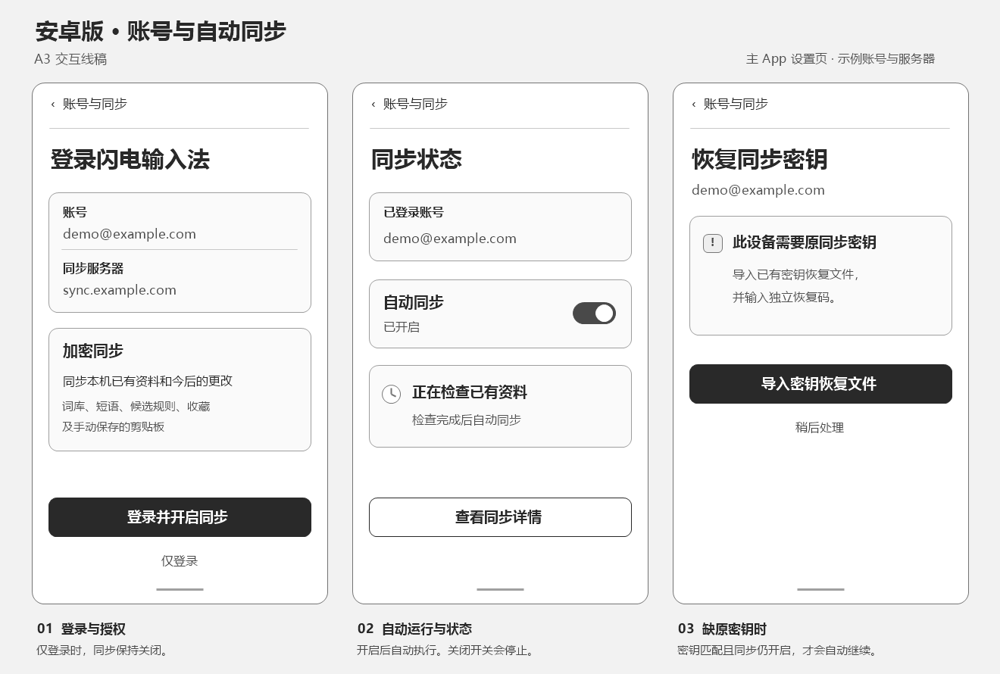

# Android 账号与自动同步 · 设计与交互

2026-11-24。三屏视觉稿、线稿、交互和[实施计划](../ANDROID_ACCOUNT_SYNC_IMPLEMENTATION.md)已获用户确认。本稿中的账号和服务器为示例。

## 交互步骤

| 场景 | 操作与反馈 |
| --- | --- |
| 登录并开启 | 入口是主 App「账号与同步」。首屏在按钮前列出同步范围：已有及以后新增或修改的个人词库、快捷短语、候选规则、永久收藏和手动保存的剪贴板。按「登录并开启同步」进入登录校验，处理期间禁用重复提交。取消或失败时保持本机关，保留可重试的登录页。若实际登录的服务器或账号与此前展示的不同，展示实际目标并重新取得同意。 |
| 仅登录 | 校验成功后进入状态页，开关显示「已关闭」。可以正常使用本机资料。以后点开关时先查看范围并点「开启加密同步」，这次确认后才启动资料同步。 |
| 自动首次同步 | 设备授权有效、加密密钥匹配且开关已开启时，登录完成后自动开始。先显示「正在检查已有资料」，认证拉取到本轮终止页，再核对本机已有记录、版本和来源。检查通过的资料自动排队，随后加密同步。未读到终止页继续从已保存游标读取，检查未完成时维持等待或检查中状态。 |
| 自动日常同步 | A3 首个可运行版本在主 App 启动或回到前台时自动检查，前台内网络恢复时继续。已有任务时合并重复触发。状态页可随时打开查看，日常同步不需要逐条选择。后台调度进入后续技术评审。 |
| 恢复原密钥 | 已登记密钥的账号在本机缺少原密钥时显示「需要恢复同步密钥」。选择原恢复文件并输入独立恢复码。文件取消、恢复码错误或资料库绑定不匹配时留在需要处理状态，现有本机资料与材料保留。点「稍后处理」返回状态页。恢复同一把密钥后，只有当前账号、设备授权及本次开启同意仍有效才自动继续。 |

账号已经登录但设备尚未获授权时，状态页单独显示「此设备尚未获授权」。新建的无历史空账号走所有者确认的首次密钥登记。已有历史且无法核对密钥的账号保留现状，从对应异常入口处理。

## 同步状态与停止

| 用户看到的状态 | 触发条件和处理 |
| --- | --- |
| 已关闭 | 从未开启、仅登录或主动关闭。关闭后停止发起新传输，排队和未确认的冻结请求保留。重新开启显示当前账号和资料范围后再确认。 |
| 等待网络 / 正在检查 / 正在同步 | 前台离线时显示等待网络。网络可用后校验目标、设备、密钥及授权，再检查远端和本机，最后发送已冻结的实际操作。只显示真实进度。 |
| 等待核实 | 请求已发出，尚无已校验并保存的回执。重试时继续使用原冻结密文；服务端回执在本机验证、保存后才将对应版本标记为已确认。 |
| 最近同步成功 | 本轮已检查的范围显示完成时间。详情区分已确认的版本、已排队和仅在本机的变更。开关已开启、队列暂时为空与本轮同步结果分别显示。 |
| 有资料需要处理 / 设备授权失效 | 展示具体原因及入口，例如冲突详情、恢复密钥或重新授权。重叠 ID、词库重复、旧墓碑、来源无法核验或不同账号绑定均保留本机资料。拉取页被拒时整页回滚、游标保持原值，并暂停本轮。重新授权后再检查当前设备及密钥。 |

退出登录、关闭开关或切换账号使旧任务失效。已送达的请求可能随后完成，保留回执与原请求，在原目标恢复后核实。迟到的登录、密钥恢复或任务回调不得恢复已关闭的授权。同一设备重开 App 只承接本机持久保存的有效开启同意，并在发起本轮前重新校验；备份与恢复文件只作资料或密钥输入，不能提供开启许可。刚导入且来源无法核验的存量放在本机，状态页提示用户处理。

## 已确认的视觉稿

沿用安卓版浅蓝灰底、白色卡片和蓝色主操作。绿色表示开关已启用，琥珀色表示需要用户处理。首屏正文把资料范围放在授权按钮之前，日常状态页仅提供查看和开关控制。

## 接手

1. 进度按[实施计划](../ANDROID_ACCOUNT_SYNC_IMPLEMENTATION.md)记录。当前验证隔离环境的真实登录、回跳和设备授权，首次双端合成短语验收另记。
2. A2 草稿 PR #125 的合成双端服务验收作为共享安全基础。当前通过三屏和文案的静态核对，A3 Android 真机及模拟器验收属于实现阶段。

## 项目记忆

- 登录身份、设备授权、同步密钥和用户的同步同意各有边界。开启意愿绑定当前服务器、账号和设备。已登记账号等待恢复时进一步锁定远端密钥身份，恢复成功后以匹配的本机绑定和完整密钥身份校验。服务器、账号、设备或密钥身份变更时重新确认。
- 已开启后自动处理符合条件的本机资料。首轮先认证拉取至终止页，再核对存量版本与冲突；保留墓碑、原冻结请求和回执。只有校验并持久保存的回执证明服务器已确认。输入线程继续独立于同步。
- 视觉核对由主智能体完成，Astra 对改版范围与依赖做了独立只读审查。生成工具为内置 imagegen，提示词限定三个等宽的主 App 场景、准确简体中文、现有蓝灰原生设置样式、首屏范围文案、检查中状态和缺密钥恢复入口。

依据见 [Android 手动同步现有契约](../ANDROID_MANUAL_SYNC.md) 与 [A2 同步服务验收](https://github.com/ForceMind/ZapIME/actions/runs/45395869314)。
