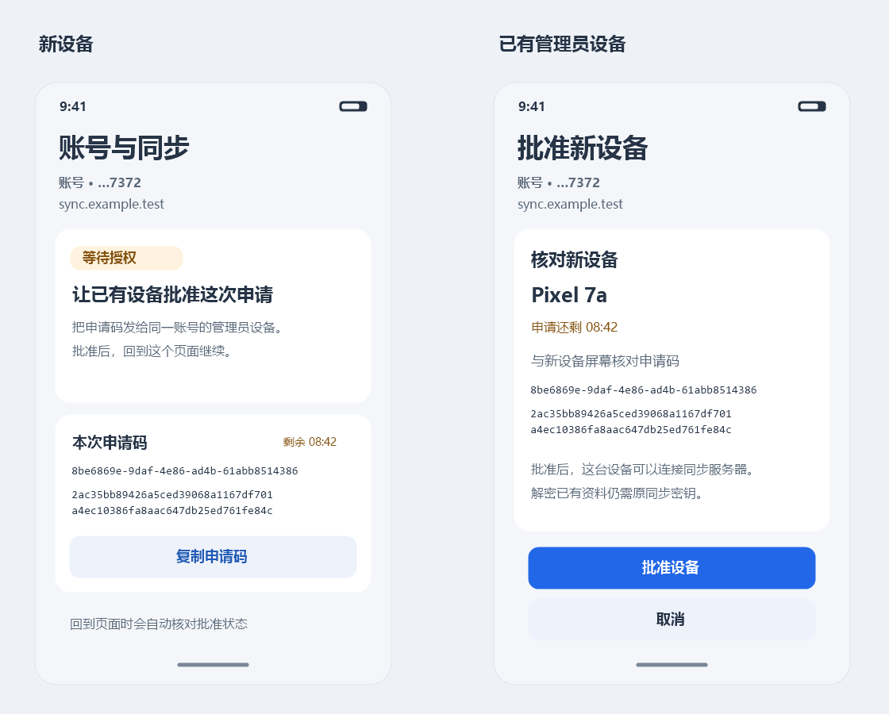

# Android 新设备首次授权效果图

2026-11-24。视觉方案待确认。当前交付是新设备等待页和同账号管理员设备批准页。用户确认后再交线稿与交互。

沿用安卓版浅蓝灰背景、白色卡片、蓝色主按钮。琥珀色用于等待和即将过期。效果图上的账号、服务器、设备名和申请码均为合成示例。

新设备页让用户把当前申请码交给已有管理员设备。管理员设备展示待批准设备、同一申请码及有效期，用户核对后批准。申请码包含申请 ID 和完整指纹，可通过系统剪贴板显式复制。示意图显示的是批准前的核对状态。

新设备回到页面时检查授权。已有设备有效时沿用登录后自动同步的原设计。设备批准仅授予设备连接权，已有资料仍需同一账号的原同步密钥。

依据见[已确认的账号和同步设计](ANDROID_ACCOUNT_SYNC.md)及[设备登记服务协议](../../services/sync/README.md#设备登记协议)。
