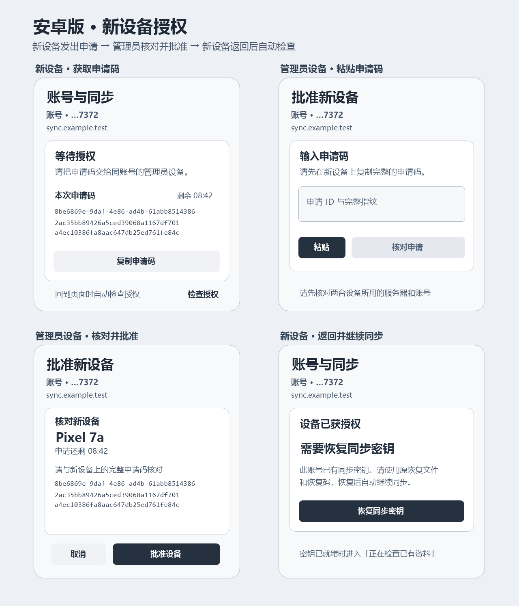

# Android 新设备首次授权 · 线稿与交互

2026-11-24。用户已确认视觉方向。本轮交付四屏线稿与交互，等待确认后进入实现。示例账号、服务器、设备名和申请码均为合成值。

## 四步交互

| 屏幕 | 触发、操作与反馈 |
| --- | --- |
| 新设备 · 获取申请码 | 主 App「账号与同步」中选择「登录并开启同步」。实际登录成功且当前目标已确认、设备尚未获授权时，自动发起一笔设备申请。先显示「正在生成申请码」，收到已核对的服务回执后展示服务器、账号、有效期、申请 ID 和完整指纹。点「复制申请码」提示已复制，用户再把申请码交给管理员。已选「仅登录」的用户可显式点「申请设备授权」，同步仍保持关闭。 |
| 管理员设备 · 粘贴申请码 | 同账号已有有效管理员设备从「账号与同步」打开「批准新设备」。页面先显示当前服务器和账号。用户可主动点「粘贴」或手动输入完整申请码，格式有效后才能点「核对申请」。读取期间显示「正在核对申请」，输入保留，暂停重复核对。 |
| 管理员设备 · 核对并批准 | 展示服务读回的设备自报名称、剩余有效期和完整申请码。管理员对照新设备并明确点「批准设备」，提交期间锁定按钮。服务确认后显示「已批准，请回到新设备继续」。点「取消」返回上一页，该申请继续等待。编辑申请码、更换账号或服务器后，旧核对结果立即失效。 |
| 新设备 · 返回并继续同步 | 回到同一账号页时自动检查一次，也可点「检查授权」。先领取凭据，再以实际服务会话核对新设备并安全保存，之后才显示「设备已获授权」。若原开启同意仍可核实且密钥匹配，进入「正在检查已有资料」并自动同步。缺少已登记密钥时进入现有恢复页，恢复原密钥并重新核对授权后继续。仅登录或此前开启同意无法核实时，同步保持关闭，可由用户在现有入口明确开启。 |

已有有效设备登录后沿用已确认的自动同步路径。新设备先取得设备授权，再按当前账号的密钥状态和同步同意继续。[账号与自动同步设计](ANDROID_ACCOUNT_SYNC.md)

## 异常状态与恢复

| 情况 | 用户看到的反馈与恢复操作 |
| --- | --- |
| 缺少申请码或格式不完整 | 保持输入页，提示「请粘贴完整申请码」。格式有效时才开放核对。 |
| 对不上服务器、账号、指纹或管理员权限 | 保持核对入口，提示「找不到可核对的申请，请检查服务器、账号和完整申请码」。只有同账号有效管理员核对到完全匹配的请求，才可看到其设备资料或处理状态。 |
| 待批准、已过期或已处理 | 仍待批准时显示「等待授权」。申请过期时，先用原凭据查询会话。只有确认旧申请过期且原设备无有效授权时，才显示「申请已过期」并开放「重新申请」。管理员页对服务已确认处理的原请求显示「已批准，等待新设备继续」或「此申请已处理」。 |
| 断网或批准结果不确定 | 保留当前申请和账号。断网时显示「等待网络恢复」。批准回执不确定时显示「批准结果待核实」，用户可重新核对。服务确认仍待批准后，才恢复批准按钮。 |
| 短时登录凭证失效或 App 重启 | 需要新票据时，在新设备显示「重新验证登录」并由用户打开系统浏览器。原服务器、账号及主体核对通过后，在有效期内继续原申请。回跳账号不同则保留原申请并提示核对。需要换号时由用户另行选择，按新目标取得同步同意。 |
| 领取回执或本机保存结果不确定 | 显示「正在核实设备授权」。使用原申请凭据查询会话，并按同一申请继续核实及保存。仅在核实成功后显示已授权。若同一账号已无可用管理员设备，提示联系同步服务管理员处理。 |
| 换号、退出或取消 | 旧页面操作随当前会话失效，已到达服务的操作由原账号在之后核实。账号或部署改变时重新展示实际目标并取得同步同意。 |

## 实现接手与验收

- 在管理员批准前增加同账号、有效 owner 范围内的只读核对。请求体带申请 ID 和完整指纹，展示数据以服务回读为准。批准按原申请再次检查权限、指纹、有效期及处理状态。详情失效后要重新核对。
- 新设备沿用短时令牌、原申请密钥、Keystore 暂存和独立会话验证。同一申请合并前台的重复检查。只在同一会话代次和已核对的目标下领取、保存或继续同步。已登记账号仍恢复原密钥。
- 验收包括完整正向流程、仅登录保持关闭、跨账号及非管理员拒绝、过期、重复操作、丢回执后的核对、缺密钥、换号和取消。Astra 已完成只读交互方案审查，当前成果已做静态核对。确认线稿与交互后进入实现及实机验证。

## 已确认的效果图

沿用安卓版浅蓝灰背景、白色卡片、蓝色主按钮。琥珀色用于等待和即将过期。

依据见[设备登记服务协议](../../services/sync/README.md#设备登记协议)与[A3 实施计划](../ANDROID_ACCOUNT_SYNC_IMPLEMENTATION.md)。
