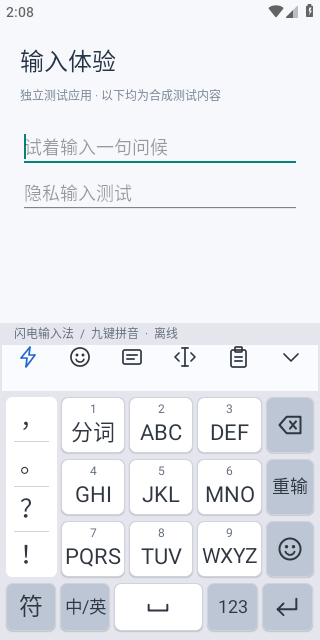
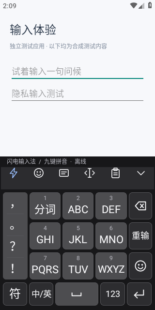
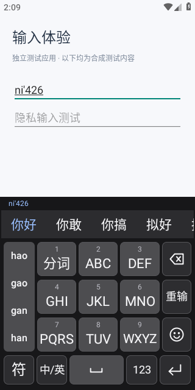
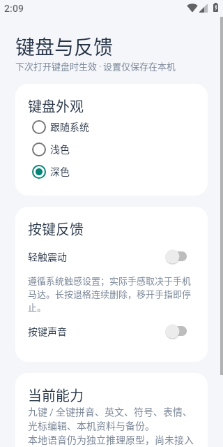
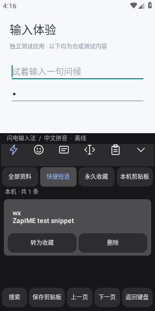
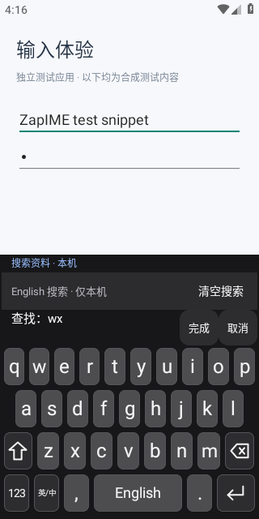

# Android 原生键盘与输入体验

2026-10-23，按用户提供的 QQ 日间/夜间九键截图重新实现 ZapIME 原生键盘。只参考布局与交互，没有导入 QQ 头像、皮肤、图标或其它素材；图标由 Canvas 独立绘制，输入核心继续固定在 MSIME 既有版本。其他公开项目的核查见 [键盘参考](KEYBOARD_REFERENCES.md)。

## 当前布局

- 空闲工具栏依次为工具、表情、九键/全键切换、光标编辑、本机资料、收起；组字时同一区域显示可横向滚动的候选。
- 九键左侧是四个常用标点；输入时替换为纵向可滚动的读音，中央三行九宫格保持原位。小数字位于大字母上方，右侧为退格、重输、表情。
- 底部为符号、中英、宽空格、数字、回车。空格显示空格符号；语音未接入前不放假麦克风入口。
- 九键整体约 317dp，全键约 282dp。标点触摸高度至少 44dp，中央键帽 56dp，底栏键帽 48dp。字母按可用宽度缩放，避免 WXYZ 裁切；读音与候选更新不挤动主键位。
- 数字、符号、常用表情与光标编辑面板可实际操作；全选/复制/剪切/粘贴通过当前 InputConnection，隐私会话禁止复制/剪切。显式粘贴不等于云剪贴板或自动历史采集。
- 跟随系统/浅色/深色与反馈设置只保存在本机。键盘主题是实例级对象，主 App 目前仍为浅色。

| 配色 | 浅色 | 深色 |
| --- | --- | --- |
| 键盘底 | `#e5e6ed` | `#171719` |
| 字母键帽 | `#ffffff` | `#4d4d50` |
| 操作键帽 | `#bdc6d4` | `#2d2d30` |
| 文字 | `#303741` | `#f5f5f7` |
| 首候选 | `#2366cb` | `#99bfff` |

## 反馈与安全

使用系统 `View.performHapticFeedback(KEYBOARD_TAP)`，不申请 VIBRATE、不绕过系统触感关闭。应用触感默认开启，关闭时也禁用按键默认长按反馈；声音默认关闭，启用后仍使用系统声音接口。模拟器不能验证手机马达手感。

退格按下删除一次，380ms 后每 65ms 重复；抬手、触摸取消、移出、多指、面板销毁、键盘隐藏、失焦与服务销毁时取消重复。重复不叠加震动；异步编辑仍校验焦点 epoch。选区删除与 ICU 字素边界删除已纳入验收，覆盖心形变体符、肤色、旗帜、ZWJ 家庭和组合重音。上下文读取最多 1024 UTF-16 单元；无法判定完整边界时交给编辑器删除，无上下文时保留码点回退。仍需其它 App、系统 Unicode 版本和超长片段专项兼容。

候选和读音继续校验 generation；重输只取消 IME 自己的组字，不删除输入框中已提交内容。初始化/空结果不以空组字覆盖任意选区。密码和不允许学习的字段继续使用隐私会话，网络不参与输入路径。

## 布局原始证据

验证代码：0544a557d3f99f5c1fc4e10c0fdca5736a64a66a。[CI 39966378186](https://github.com/ForceMind/ZapIME/actions/runs/39966378186) 双架构 APK、API28 两轮完整输入及切回 AOSP 后的真实 IME 服务退出均通过，无本轮应用 fatal。原始归档 SHA256 为 `8f2b7202105f997303d94452eb298377641c076c7d1db13956a9831beae33a82`。

下方为归档第二轮原始 320×640 图片，字节与 artifact 一致，未重绘或裁剪；上半屏是独立合成测试 App，下半屏是真正的 ZapIME 输入法。设置截图为 ZapIME 原生 Activity。

| 浅色九键 | 深色九键 |
| --- | --- |
|  |  |

| 深色候选与读音 | 键盘与反馈设置 |
| --- | --- |
|  |  |

原始分轮输入/runtime/退出记录见同目录；[CI 摘要](../evidence/android-qq-ci-39966378186.log) 保留早期失败。候选物理触摸、手机马达和其它平台不计为本轮已验收。

新增回归：浅/深键帽实际像素、主题与震动关闭持久设置、九键重输、四个标点、表情上屏及删除、显式复制粘贴、长按退格重复/取消/移出/跨焦点、Unicode 与选区删除。原有中英、全键/九键、个人短语、隐私字段、重启选区保护及真实 IME 服务退出仍继续执行。

独立测试 App 通过真实 InputConnection 观察结果；普通键位/读音/焦点使用触屏，候选选择使用指定 Button 的无障碍 ACTION_CLICK。正文从测试 Activity 的真实 Editable 读取，避免空编辑器的无障碍文本返回 hint。所有文本均为合成内容，未使用真实剪贴板。

## 追加字素删除复验

自动审阅指出提供的 `❤️` 键只按码点退格会留下心形。a77a97c495ba098f8f0a7766135518a84f3ef910 改为有界 ICU 字素边界删除；[39968475503](https://github.com/ForceMind/ZapIME/actions/runs/39968475503) 双架构和 API28 两轮完整原生验收成功，包括实际点击心形键、心形/肤色/旗帜/ZWJ 家庭/重音簇和选区删除，以及原有输入、主题、重复退格与真实服务退出，无当轮 fatal。

[复验摘要](../evidence/android-grapheme-ci-39968475503.log) 独立保存；GitHub 报告本次 artifact digest `5eeaec5104fefbcba556a53eb0f5ca1ff2f21ce4237ca20b41761dc08354b32b`，未另行下载该归档，不冒充本地哈希验证。上方 UI 原图仍明确来自已下载校验的布局轮，后续修复未改变键盘外观。

## 键盘内本机资料与搜索

验证代码 c8f99e06af6079d610b2a6c67600b342ec14cd48；[Android CI 39984560789](https://github.com/ForceMind/ZapIME/actions/runs/39984560789) 双架构、API28 两轮完整输入/面板操作/真实服务退出均成功，无当轮应用 fatal。新增英文/中文搜索只更新独立查询缓冲区；快速按键后清空、组字中取消、失焦和禁止学习字段拒绝均执行。

下方为 round-2 原始截图，全部是合成文本，未重绘/裁剪。下载 ZIP 后校验 SHA256 `ba09a728fbd6f6a1b8357f049b6ab3af1ea8eb8ce2da271d51e7c4bbf17b139e`，归档的四张资料截图逐字节保存；剪贴板/收藏截图保留系统 Toast 原貌，未做遮挡清除。原始分轮输入/runtime/退出日志同存 [证据目录](../evidence/ui-local-data-39984560789/)。

| 本机资料列表 | 独立搜索键盘 |
| --- | --- |
|  |  |

列表使用跟随键盘的明暗配色；分类、分页与搜索都只读本地。点击条目时按修订与期限复核，再从库读取完整正文上屏；预览不会被误当作正文。完成/取消在组字时也保持可用。剪贴板仅在显式保存时读取，7 天过期；置顶不延期，转收藏创建永久副本。详见 [资料契约](../LOCAL_DATA_PANEL.md)。

大库审阅修正后，查询用独立只读线程、SQLite 过滤/索引排序/分页和进度预算，最多返回 40 条摘要；不会把正文集合反序列化到键盘输入队列。6000 条长正文与无临时排序用例是功能/计划证据，仍需十万条和低内存手机性能验收。

## 完整体验边界

| 功能 | 本切片范围 | 尚待完成/验收 |
| --- | --- | --- |
| 中文、英文、九键/全键 | 固定核心、读音侧栏、重输、数字/符号 | 长句/高频/多 App、候选物理触摸、三星真机 |
| 外观 | 键盘系统/浅/深配色 | 主 App 暗色、横屏、大字号、键高、单手模式 |
| 触感与编辑 | 系统触感开关、可选声音、连续退格、显式编辑 | 真机马达/静音、其它 App/超长组合字符、滑动光标与长按弹窗 |
| 表情 | 一组常用表情可插入 | 完整表情搜索与分类 |
| 本机资料 | 管理与备份；键盘内搜索、插入、剪贴板置顶/转收藏/确认删除 | 历史容量/期限设置、大库/真机、其它三端管理和云端接入 |
| 语音和云同步 | 独立推理原型、独立服务及上传准备层 | 键盘录音、四端联网客户端、设备配对和完整恢复 UI |

交互跟踪 [#27](https://github.com/ForceMind/ZapIME/issues/27)，语音 [#24](https://github.com/ForceMind/ZapIME/issues/24)，同步 [#8](https://github.com/ForceMind/ZapIME/issues/8)。这些缺口不因一次构建或截图被标作产品全部完成。

## 历史证据

- 2026-10-22 浅色全键：[39776837197](https://github.com/ForceMind/ZapIME/actions/runs/39776837197)，fa23f867870d556d3e9c20193bed0f6cb3d509a1，两轮输入及真实服务退出通过；[原始图片](../evidence/ui-android-39776837197/)，归档 SHA256 `1b29d34de5aabadc2cdf71e8f11bfcb57f0becdc4ddc2b90bf51b1e4c71b22cb`。
- 2026-10-23 早期九键：[39898390355](https://github.com/ForceMind/ZapIME/actions/runs/39898390355)，b50fbbd6585f041abce3751fd27df93e9fd00ebb，九键/全键/读音/短语/数字/隐私/重启选区及退出通过；[原始图片](../evidence/ui-nine-key-39898390355/nine-key.png)，归档 SHA256 `1da24250166b3bf89ad4e8b94a433488add2af8f3503220b66a3c500957fe02d`。该版本的横向读音行已被本轮侧栏替换。
- 本轮前两次新增测试分别暴露已有任务页跳转/滚动定位、空编辑器 hint 误判；第三次捕获真实的全角问号/叹号误送 ASCII 核心错误。完整失败与修正记录见 STATUS.md 与本轮 CI 摘要，不把失败轮当成功。
