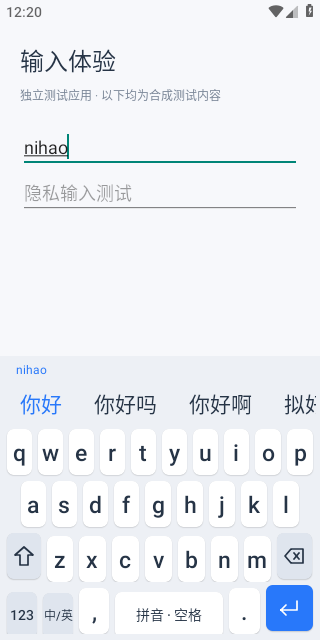
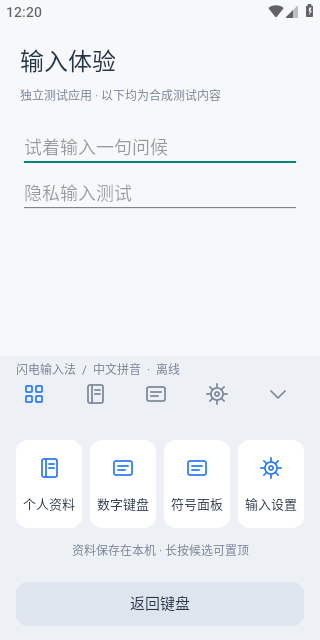
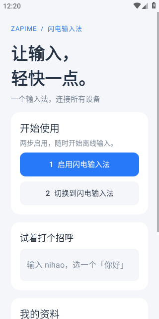
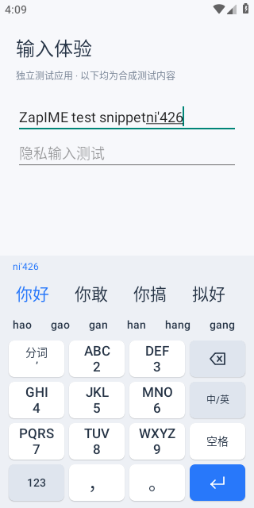

# Android 原生界面 · 2026-10-22

用户要求参考 QQ 输入法，替换未设计的默认 Android 按钮界面。参考入口为 QQ 输入法官网 https://qq.pinyin.cn/ 与官方应用商店展示 https://m.app.mi.com/details?id=com.tencent.qqpinyin 。参考交互层级和紧凑布局；没有复制 QQ 标识、皮肤、图标或其它素材。

## 视觉与操作

- 冷白键帽、浅灰蓝底、深色字形，蓝色首候选和回车键。原创线条图标直接由 Android Canvas 绘制。
- 主键盘为四排，字母区错位对齐，Shift/退格加宽；常驻数字行改为独立数字面板。主体按键区域 208dp，头部 68dp，合计约 284dp。
- 空闲时展示可操作工具栏；组字时同一区域展示横向可滚动候选。组字文本和首候选以蓝色强调，候选更新仍校验 generation。
- 独立数字、中文符号面板；工具页提供资料管理、数字、符号、输入设置。只有已经接通的操作才展示，收起动作使用系统 IME 接口。
- 设置和个人资料采用统一原生卡片、表单、主次操作。保留明文备份确认，不显示虚假的云连接状态。
- 键帽触摸高度 46dp，保留可读的无障碍名称；大小写有可见字母/Shift 状态，隐私输入明确展示不学习。

## 验证和边界

通过独立测试应用的真实 InputConnection 验证，记录普通键盘、组字候选、工具、数字面板、主界面、个人资料和短语插入后的原生屏幕截图。候选选择走指定 Button 的无障碍 ACTION_CLICK，普通键位及焦点走触屏注入；不是候选物理触摸验收。两轮分别清空专用 CI 模拟器的合成资料，保留结果。

本切片仅 Android 浅色界面。2026-10-23 已新增九键源码与核心测试：空闲工具栏切换全键/九键，九宫格右侧为退格/中英/空格，组字时增加可横向滚动的读音行。Android 实际验收以 STATUS.md 新记录为准；下方截图仍为此前全键版本。暗色/大字号/横屏专项适配、语音、剪贴板键盘内列表、云端状态及其余平台视觉仍未完成；不能以本切片替代 M5 全部验收。所有示例和截图使用合成文本。

## 原生画面

以下为 CI [39776837197](https://github.com/ForceMind/ZapIME/actions/runs/39776837197) 的 API28 模拟器原始截图，验证代码 fa23f867870d556d3e9c20193bed0f6cb3d509a1。每轮均验证输入与真实服务退出，无本轮 ZapIME fatal。键盘截图上半屏为独立合成测试 App，下半屏为真正的 ZapIME InputMethodService；主界面为 ZapIME 原生 Activity。

| 拼音候选 | 工具面板 | 原生设置首页 |
| --- | --- | --- |
|  |  |  |

同一 CI artifact 含两轮各七张原始截图、arm64/x86_64 开发 APK、输入日志、服务退出和运行时日志；归档 SHA-256 为 1b29d34de5aabadc2cdf71e8f11bfcb57f0becdc4ddc2b90bf51b1e4c71b22cb。本页三张图片直接取自该归档，没有重绘或修改。

## 九键实际画面 · 2026-10-23

CI [39898390355](https://github.com/ForceMind/ZapIME/actions/runs/39898390355)，验证代码 b50fbbd6585f041abce3751fd27df93e9fd00ebb；双架构开发包和 API28 两轮九键/全键输入及服务退出通过。最新键位行取消混合文字/图标基线对齐，避免双行键帽裁切；读音行在九键中固定保留，候选刷新不移动按键。九键置顶记录完整拼音，与全键共享并尊重锁定读音。

原始 320×640 模拟器截图：上半屏为独立合成测试 App，下半屏为真实 ZapIME 输入法；未重绘、未裁剪。候选仍用指定 Button 无障碍动作，普通键位/读音走触屏；不是 ARM 真机或全平台视觉验收。原始 artifact SHA256：1da24250166b3bf89ad4e8b94a433488add2af8f3503220b66a3c500957fe02d。

## 用户截图参考改造 · 2026-10-23（验证中）

新增 KeyboardTheme / KeyCap / KeyboardTouch 与原生键盘反馈设置页；九键采用标点侧栏、上标数字、大字母键帽、右侧退格/重输/表情和五项底栏。空格宽度独立增加，保留空格含义，不用尚未集成的麦克风装饰。浅色白键/灰蓝操作键，深色炭黑底/灰色字母键。主题为键盘独立实例，主 App 仍为浅色，不虚称全 App 适配。

工具栏提供工具、表情、布局、光标编辑、本机资料、收起；表情可实际上屏，编辑面板使用 InputConnection 光标和显式复制/剪切/粘贴，隐私会话禁止复制/剪切。复制不等于云剪贴板或自动采集历史。候选与读音仍保持代次检查，九键读音区域保留固定高度。

此次参考项目：语燕 https://github.com/gurecn/YuyanIme （九键、单手、深色交互）、同文 https://github.com/osfans/trime （Rime 平台）、小企鹅 https://github.com/fcitx5-android/fcitx5-android 、HeliBoard https://github.com/HeliBorg/HeliBoard （按键反馈、可定制主题与显式剪贴板）。不将 GitHub star 当商店评分，不确定用户记忆中具体是哪款。只研究公开功能/交互，没有导入上述项目源码、资源或词库；后续移植必须逐组件审计，不能只看根许可证。

新增原生回归覆盖主题设置与持久震动关闭、浅/深九键截图、重输、标点、表情上屏、显式复制粘贴，以及退格连续删除/取消/移出/失焦/Unicode/选区。尚待真实 CI，不把源码或截图测试清单写成已通过。三星真机触感、候选物理触摸、横屏/大字号与其余平台仍需专项验收。
