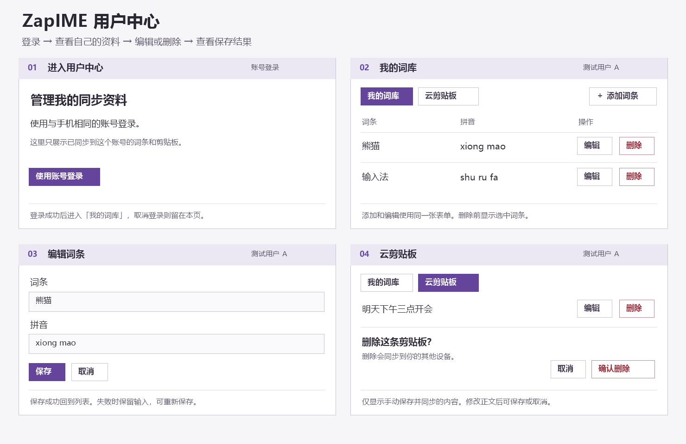
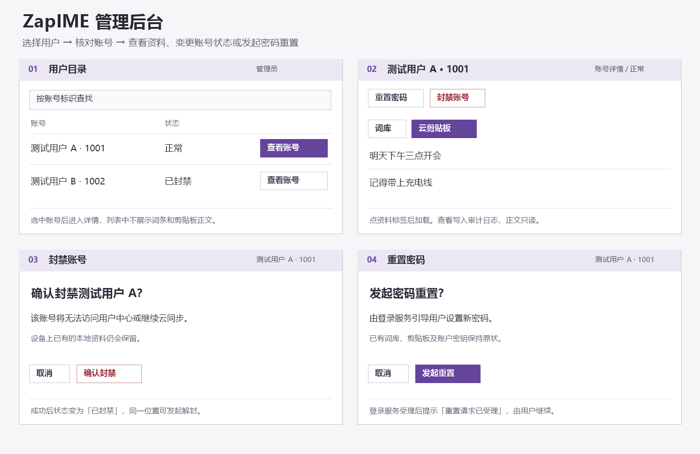

# 用户中心与管理后台 · 交互线稿

2026-11-25。紫色视觉方向已确认。当前交付为操作线稿，等待交互确认。示例账号、编号和正文均为合成数据。

## 用户管理自己的资料

| 操作 | 反馈与恢复 |
| --- | --- |
| 用手机上的账号登录 | 从现有身份提供方返回后打开自己的词库。登录取消可重试。会话失效后收起资料并提示重新登录，切换账号时清除前一个账号的内容和编辑草稿。 |
| 切换词库或云剪贴板 | 加载期间显示对应资料的加载提示。空词库提供「添加词条」，空剪贴板提示在手机上手动保存并同步。请求失败可重试；仅在成功读取后显示空状态。 |
| 添加或编辑词条、编辑剪贴板 | 展示选中条目的现值，必填项为空时在字段下提示。服务端确认后回到列表并显示更新结果。另一设备先行修改时保留草稿，提示查看最新版本再保存。剪贴板过期时结束编辑并刷新列表。 |
| 删除词条或剪贴板条目 | 确认区紧邻所选条目，提示变更会同步至其他设备。取消返回原处。等待响应时阻止重复提交；结果未知时先刷新核对。 |
| 旧资料需要迁移 | 显示「旧资料待迁移」及回到已解锁原设备或使用恢复包与恢复码的指引。完成后重新载入。只有密钥可用且读取成功，才能显示正文。 |

## 管理员管理注册用户

| 操作 | 反馈与恢复 |
| --- | --- |
| 进入用户目录，选择账号 | 管理员登录后可查找注册用户，详情固定显示所选账号标识及状态。普通用户直接打开管理地址时返回无权限。切换账号立即清除上一个账号的正文，丢弃迟到的加载结果。 |
| 查看词库或云剪贴板 | 在所选账号下点击标签，告知此次查看会留痕。服务端核验管理员权限并记录查看人、目标账号、资料类别和时间后返回只读正文。权限或审计失败时不展示正文。日志不保存词条或剪贴板文字。 |
| 封禁或解封 | 确认框显示目标账号、当前状态和操作影响。确认封禁后，用户中心和云同步均须对已有会话及新的访问生效。设备上已保存的本地副本仍可用。解封的确认框提示恢复访问资格；服务端确认后更新状态。请求结果不明时重新获取状态。 |
| 发起密码重置 | 显示目标账号，请登录服务受理。受理后提示用户按登录服务指引设置新密码。提供方未配置重置能力时显示原因并禁用入口；超时显示结果待核实。密码重置与资料密钥恢复独立。 |

## 接手与确认

- 两张图按操作拆屏，实际桌面布局沿用已确认效果图中的用户侧栏和管理员用户目录。紫色表示当前项和主操作，红色用于删除与封禁。
- 服务端托管密钥适用于采用新模式的账户。开启该模式前向用户明确说明授权管理员可查看已同步正文。旧账户须在具备原密钥的条件下确认迁移。现有密钥和账号连接见 [Android 本机同步准备](../ANDROID_SYNC_PREPARATION.md) 与 [Android 手动同步](../ANDROID_MANUAL_SYNC.md)。
- 已完成两组线稿和交互说明，并逐图检查可读性。下一步是确认用户编辑与删除、管理员查看与封禁、解封及密码重置的路径。产品页面、密钥迁移和上线属于后续实施阶段。
